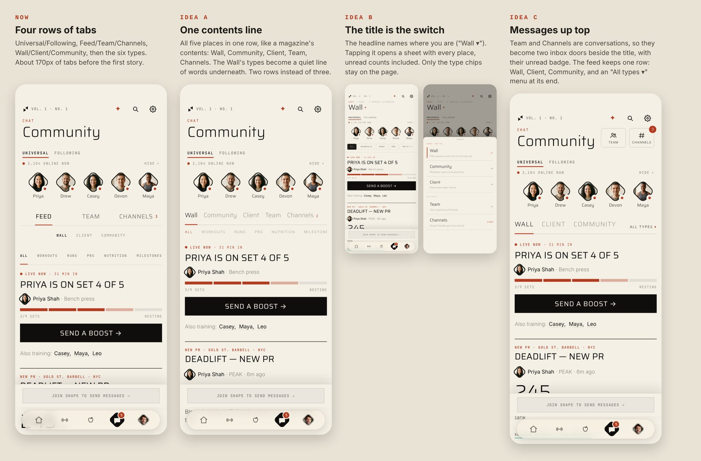

# Chat's places — the three ideas, and the one kept in reserve (2026-10-26)

The owner, on the Chat page's stacked tab rows (Feed / Team / Channels over Wall / Client / Community
over the six types): *"still dont love the look of this"*, *"need to figure out how else to display
this"*, *"give me 3 new ideas"*. Then: *"go with B"*, and *"keep A though as ammo in case i want to
change"*.

Each idea was drawn into the running signed-out preview (cream paper, 375×867), so only the navigation
differs from the real page.

## Before

Four rows of controls stood between the online rail and the first story, about 170px:
Universal / Following, then Feed / Team / Channels, then Wall / Client / Community, then All / Workouts /
Runs / PRs / Nutrition / Milestones.

## B — the title is the switch (shipped)

The page's title names the place you are in ("Wall ▾") and opens a sheet of every place: Wall,
Community and the viewer's own role feed, then **Messages**: Team and Channels with their unread. The
kicker reads "Chat · N unread elsewhere" when a place the page is not showing has unread. Only the
Wall's type chips stay on the page. Code: `mobile-app/src/broadsheet/BSChatPlaces.jsx`; tests:
`tests/chat-places.test.mjs`.

## A — one contents line (kept in reserve)

The five places in **one row**, like a magazine's contents, and the Wall's types a quiet line of words
under it. Two rows instead of three, and nothing hidden behind a tap.

How to build it from B, if the owner switches:

- **The row.** Under the rail, one row on the Wall's 12px edge, over a hairline: `Wall · Community ·
  {role} · Team · Channels`, in the headline face (Saira) at 15.5px, title case. The active place is
  ink at weight 600 with the magazine red (`bsWsRed`) as a 2px underline on the hairline; the rest are
  ink at 42%. Gaps of 15px fit all five at 375px in English. In a longer language the row scrolls
  sideways (`bs-hide-scroll`), like the type chips do. An unread count is a bare red number after the
  name, as on the old strip (Channels 3).
- **The feeds are still `CHIP_KEYS`.** The row offers exactly the channels B's sheet does: the viewer's
  own role feed and no other (`tests/chat-feed-tab.test.mjs` reads that definition for the website's
  scope). Wall, Community, then the role, as B orders them (`PLACE_ORDER`).
- **The title** goes back to a plain h1 naming the place (no ▾, no sheet); B's `places`, `place`,
  `pickPlace` and the unread figures carry over unchanged, so the row is a `places.map` of buttons with
  `aria-current` on the place you are in.
- **The types** become a line of mono words at 8.5px separated by ` · `, the one shown in red, no
  chips and no underline, in place of `BSWallTypes`' chips. Each word keeps a 44px target.
- **The kicker** drops "N unread elsewhere": every place's unread is on the row itself.
- **Team's Coaches / Friends** row stays as it is, and so does the scroll anchor
  (`bsSubAnchorRef`) where the strip stood.

## C — messages up top (not taken)

Team and Channels as two inbox doors (icon, label, badge) beside the title; the feed keeps one row,
Wall · Client · Community, with an "All types ▾" menu at its end.
